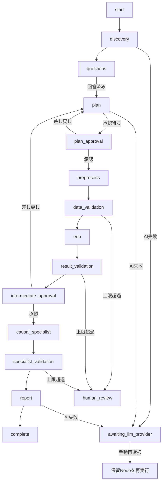

# MVP設計

## 方針

分析の再現性と説明可能性を優先し、データ処理・検証・レポート数値は決定論的なPythonで生成する。外部AIはQuestion Planner、Analysis Planner、Reflector、Reporterの構造化された判断だけを担当する。LangGraphは状態に基づくNode遷移を担い、人間の回答・承認を待つ状態では終了する。各Node完了時のStateはJSONへ、実行イベントと承認はSQLiteへ保存する。

## 状態遷移

`initialized` などの自動進行状態だけがGraph内の次Nodeへ進む。`awaiting_*`、`human_review`、`complete` はGraphを停止させ、CLI/UIがユーザー入力をStateへ反映して再度invokeする。AI失敗時は `pending_llm_operation` にタスクと再開状態だけを保存し、資格情報を保存しない。

## 信頼境界

1. Discoveryは許可拡張子とサイズ上限を検査する。
2. 初期プロファイルは制限付きサンプルのみをpandasで解析する。CSV行数はバイト列の改行を数えるメタデータで、全量統計ではない。
3. PYやREADMEはUTF-8テキストとして読み、内容を命令として実行しない。
4. 原本を変更せず、前処理結果を新規Parquet（利用不可時はCSV）として保存する。
5. 表示層は `report_data.json` とそのprovenanceが指す検証済み成果物だけを参照する。
6. 外部AIへはパスを除去した依頼、列メタデータ、回答値、検証済み集計だけを送る。サンプル行、関連資料本文、パス、シークレットは送らない。
7. ChatGPTのOAuthトークンはプロセス内だけに保持する。OpenRouterキーは環境変数だけから読む。Stateと `llm/` 監査成果物には秘密情報を保存しない。
8. LLM出力はPydanticと許可IDで検証し、修復は一度だけ行う。失敗時は自動フォールバックせず `awaiting_llm_provider` で停止する。

## 因果分析

分析範囲が因果推論を含む場合だけ質問ツリーとCausal Specialistを起動する。次をすべて満たす場合に回帰調整する。

- 結果列と処置列が存在する
- 結果が数値
- 処置・対照の双方が5件以上
- 完全ケース数がパラメータ数に対して十分
- ユーザーが条件付き交換可能性を妥当と判断している

未観測交絡、consistency、positivity、interferenceは自動保証できないため、仮定と制約を必ず成果物に残す。推定不能は正常な専門分析結果であり、断定値を生成しない。

## Retry

Node例外を `file_or_access`、`data_or_analysis`、`execution` に分類し、同じNodeだけ再実行する。回数はStateに保持し、`max_retries` 超過で `human_review` に停止する。承認済み原本や不要な上流Nodeは再実行しない。
