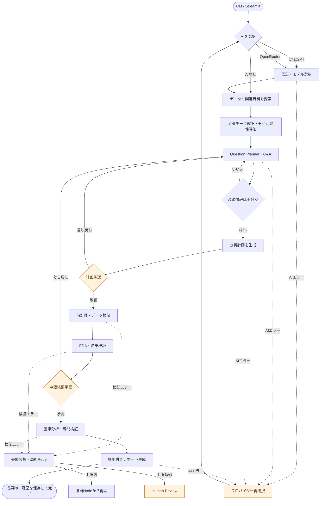

# Adaptive Data Analysis Agent

**まだ開発途中です．**

## 概要

LangGraph で分析手順と状態を管理する、対話型のデータ分析ツール。関連資料（データ）を読み取り、ユーザーへの確認、分析計画、前処理、EDA、因果分析、検証、レポート作成を一つのワークフローとして実行する。

基本的な機能:

- 分析データと関連資料の自動探索、および分析可能性の確認
- 不足情報の質問と、ユーザー承認を含む分析計画の作成
- 前処理、データ検証、基礎統計、EDA、グラフ生成
- 条件を確認した上での因果分析と専門的な検証
- Checkpointからの再開、局所Retry、実行履歴とレポートの保存
- CLIとStreamlitの両方に対応し、ChatGPT Plus/Pro、OpenRouter、AIなしから選択可能

## 処理フロー



質問、計画承認、中間結果確認では処理を一時停止します。`run_id` と同じ `thread_id` を使って再開でき、検証エラー時は失敗した処理だけを設定回数まで再実行します。

## 画面イメージ

以下は、同梱の合成売上データを分析した完了RunをStreamlitで表示した画面です。


## クイックスタート

Python 3.10以上を使用してください。

```bash
python -m venv .venv
source .venv/bin/activate
pip install -e '.[dev]'
```

### Agent本体と分析workspace

このリポジトリはAgent本体として使用し、実データはリポジトリ直下の `data-analysis/` に
案件ごとに分けて配置します。プロジェクト名だけを指定すると必要なフォルダを作成できます。

```bash
data-agent init sales-project
```

```text
Adaptive_Data_Analysis_Agent/
├── src/、app/、conf/ ...        # Agent本体
└── data-analysis/
    ├── sales-project/
    │   ├── data/                # CSV・XLSX
    │   ├── references/          # README・仕様書などの関連資料
    │   └── .data-agent/runs/    # Run成果物・状態・ログ
    └── another-project/
        ├── data/
        ├── references/
        └── .data-agent/runs/
```

対象ファイルを作成したプロジェクトの `data/` と `references/` に置いたら、そのまま起動します。

```bash
data-agent run
```

プロジェクトが1件なら自動選択し、複数なら番号で選択します。`data-analysis/<project>/` 内で
実行した場合はそのプロジェクトを自動選択します。元データは変更せず、生成物は各プロジェクトの
`.data-agent/` の中だけに保存します。別の場所を使いたい場合だけ `--workspace` を指定します。

### AIの選択

対象となるChatGPT Plus/Proアカウントを使う場合、OpenAI APIキーは不要です。`data-agent run` の選択画面で「ChatGPT Plus/Pro」を選び、`Continue with ChatGPT` からブラウザ認証します。利用できるモデルは、サインインしたアカウントのライブ一覧から選びます。OAuth認証情報はOSの資格情報ストア（macOSではKeychain）へ保存され、既定では認証から1日間再利用します。

ChatGPTプランの利用状況とアプリごとの上限は、CLI/UIに表示される `Manage usage` からChatGPT設定で確認できます。

OpenRouterを使う場合は、キーをファイルへ書かず環境変数で渡します。

```bash
export OPENROUTER_API_KEY="..."
data-agent run --provider openrouter
```

AIを使わず、従来どおり完全にローカルで実行することもできます。

```bash
data-agent run --provider deterministic
```

初回はプロバイダーと送信ポリシーの組み合わせごとにデータ送信への同意を確認します。同意と前回のプロバイダー・モデル、ChatGPTのホストID・発行済みclient IDだけをユーザー設定ディレクトリへ保存し、秘密情報は保存しません。

ChatGPT認証のコールバックは `127.0.0.1` の一時ポートを使うため、CLIとStreamlitはローカル実行を対象とします。リモート配置したStreamlitへのOAuthコールバックはこの版の対象外です。

同梱サンプルでCLIを実行します。

```bash
data-agent run --workspace examples
# prompt> data/sales.csv の売上傾向を把握したい
```

分析依頼をコマンド引数で直接渡すこともできます。

```bash
data-agent run "data/sales.csv の売上傾向を把握したい" --workspace examples
```

質問は、二択なら `y/n`、3択以上なら番号で回答します。分析範囲は `1,3` のように
カンマ区切りで複数選択できます。選択式で `0` を入力すると補足文を保存した後、元の質問へ戻ります。計画と中間結果を承認しない限り後続分析は実行されません。

Streamlit UI:

```bash
streamlit run app/streamlit_app.py
```

画面左側で `data-analysis/` 配下のプロジェクトを選択します。分析用ルートを別の場所へ置く場合は
環境変数 `DATA_AGENT_ANALYSIS_ROOT` で変更できます。Agent本体のフォルダ全体を探索することはありません。

## CLI

```bash
data-agent init <プロジェクト名> # data-analysis配下に分析プロジェクトを作成
data-agent run                 # プロジェクト選択後、分析依頼を入力
data-agent run "分析依頼"      # 分析依頼を引数で指定
data-agent run -p <プロジェクト名>
data-agent run --workspace <分析workspace>
data-agent run --provider chatgpt
data-agent run --provider openrouter --model <ライブ一覧のモデルID>
data-agent run --provider deterministic
data-agent resume <run_id>
data-agent list-runs
data-agent status <run_id>
data-agent graph --format mermaid
data-agent graph --format ascii
```

ChatGPTのOAuth認証情報はOSの資格情報ストア（macOSではKeychain）へ保存されます。
既定ではブラウザ認証から1日間だけ再利用し、アクセストークンは必要に応じて自動更新します。
1日経過後は保存済みセッションを失効・削除し、ブラウザで再サインインします。期間は
`conf/config.yaml` の `llm.chatgpt_reauth_days` で変更できます。

中断時に表示された `run_id` を `resume` に渡すと、同じ `thread_id` と最新の
`.data-agent/runs/<run_id>/state/latest.json` から再開します。整理前の `runs/` にあるRunも
一覧表示・再開できますが、新しいRunは `.data-agent/runs/` に保存されます。

## MVPの動作

- CSV/XLSXを軽量確認し、README/MD/TXT/JSON/YAML/PYをテキストとして参照します。Pythonコードは実行しません。
- 元ファイルを変更せず、前処理済みデータと変換履歴をRun配下に保存します。
- 欠損、型、重複、無限値、集計値をルールID付きで検証します。Panderaが利用可能ならスキーマ検証も実行します。
- 数値列の四分位点とカテゴリ列の頻度を含む基礎統計表、およびPlotly図表を生成します。
- CLIでは外部AIの応答待ちの間、処理内容と回転するスピナーを表示します。
- 因果分析選択時は処置、対照、介入時点、交絡、識別仮定を確認します。条件が不足する場合は推定を強行せず理由を報告します。MVPの推定法は数値アウトカムに対するHC3ロバスト標準誤差付き回帰調整です。
- Nodeの開始、終了、失敗、RetryをSQLiteとJSONLへ記録します。同一Nodeの失敗が設定上限を超えるとHuman Reviewで停止します。
- StreamlitとMarkdownは同じ `report/report_data.json` と検証済み成果物を参照します。
- AI利用時はQuestion Planner、Analysis Planner、Reflector、Reporterだけを外部モデルが担当します。自由なコード生成・実行は行いません。
- ChatGPTはOAuth認証済みResponses API、OpenRouterはChat Completionsのstrict JSON Schemaを利用します。

## 成果物

各Runは分析workspaceの `.data-agent/runs/<run_id>/` に保存されます。主なファイルは次の通りです。

```text
inputs/             探索結果、軽量プロファイル、関連資料要約
questions/          質問と回答
plans/              バージョン付き分析計画
preprocessing/      前処理済みデータと変換履歴
analysis/           記述統計と因果分析
validation/         データ・計算・専門分析・最終整合性検証
visualizations/     Plotly HTML
report/             report_data.json、Markdown、HTML
llm/                モデル、タスク、入力ハッシュ、構造化出力、遅延、利用量、失敗履歴
state/              逐次Checkpoint
logs/process.jsonl  Nodeイベント
```

`.data-agent/runs/runs.sqlite3` はRun、承認、実行イベントの索引です。元データはRunへコピーせず、パスとSHA-256だけを記録します。

## 安全性と制約

- 分析workspace外のパスは暗黙には読みません。別の分析フォルダは `--workspace` で明示してください。
- ファイルサイズと関連資料サイズには `conf/config.yaml` の上限があります。
- 関連資料内の命令はデータとして扱い、実行しません。
- 外部AIへ送るのは、パスを除去した依頼、列名・型・行数・欠損集計、回答値、検証済み集計結果だけです。生データ、サンプル行、README等の関連資料、ローカルパス、シークレットは送信しません。
- AIの出力はPydanticスキーマと許可リストで検証します。Reporterには定性文と根拠IDだけを許可し、数値は検証済み成果物からテンプレートが描画します。
- AI接続、利用上限、構造化出力の検証に失敗した場合、自動的に別プロバイダーへ切り替えません。Runを停止し、ユーザーがプロバイダーとモデルを再選択して保留中の処理を再実行します。
- 因果推定は仮定を保証しません。観測データから未観測交絡なしを検証することはできません。
- MVPは汎用表形式データを対象としますが、カテゴリ交絡の自動エンコード、DiD、予測、生成コード実行、MLflow/Hydra統合は拡張範囲です。

## テスト

```bash
pytest
ruff check .
```

受け入れシナリオは探索、質問形式、補足入力、因果分岐、未承認停止、局所Retry、Checkpoint再開、元データ保持、レポート数値一致に加え、OAuth/JWT検証、ChatGPTストリーム、OpenRouter構造化出力、スキーマ修復、プロバイダー再選択をモックで自動テストします。テストはライブ資格情報や外部APIを使用しません。
