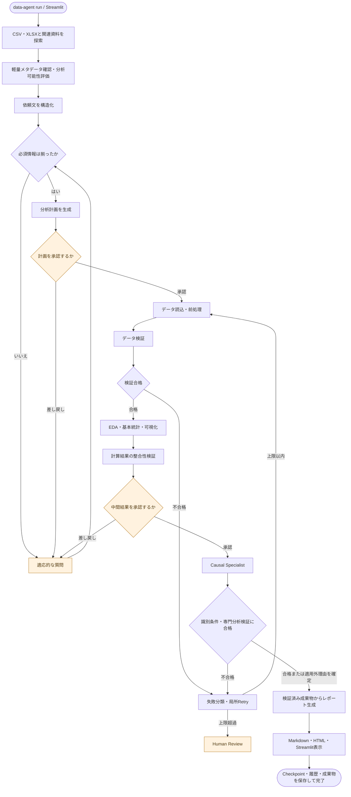
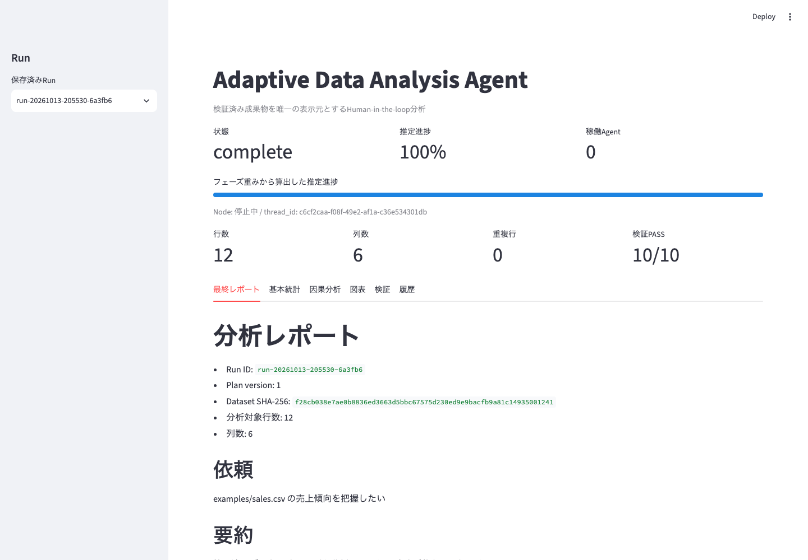

# Adaptive Data Analysis Agent

CSV/XLSXと関連資料をカレントディレクトリから安全に探索し、質問、計画承認、前処理、EDA、因果推論、検証、レポートまでを再開可能なLangGraphワークフローで実行します。外部LLMはMVPでは使用せず、データや関連コードを外部送信・自動実行しません。

## 処理フロー



質問、計画承認、中間結果確認では処理を一時停止します。`run_id` と同じ `thread_id` を使って再開でき、検証エラー時は失敗した処理だけを設定回数まで再実行します。

## 画面イメージ

以下は、同梱の合成売上データを分析した完了RunをStreamlitで表示した画面です。



## クイックスタート

Python 3.10以上を使用してください。

```bash
python -m venv .venv
source .venv/bin/activate
pip install -e '.[dev]'
```

サンプルデータでCLIを実行します。

```bash
cd examples
data-agent run
# prompt> sales.csv の売上傾向を把握したい
```

分析依頼をコマンド引数で直接渡すこともできます。

```bash
data-agent run "sales.csv の売上傾向を把握したい"
```

質問は、二択なら `y/n`、3択以上なら番号で回答します。選択式で `0` を入力すると補足文を保存した後、元の質問へ戻ります。計画と中間結果を承認しない限り後続分析は実行されません。

Streamlit UI:

```bash
streamlit run app/streamlit_app.py
```

UIをプロジェクトルートから起動すると、プロジェクト配下のCSV/XLSXを探索します。任意の分析用ディレクトリを使う場合は、そのディレクトリでCLIを実行してください。

## CLI

```bash
data-agent run                 # 起動後にプロンプトから分析依頼を入力
data-agent run "分析依頼"      # 分析依頼を引数で指定
data-agent resume <run_id>
data-agent list-runs
data-agent status <run_id>
data-agent graph --format mermaid
data-agent graph --format ascii
```

中断時に表示された `run_id` を `resume` に渡すと、同じ `thread_id` と最新の `runs/<run_id>/state/latest.json` から再開します。

## MVPの動作

- CSV/XLSXを軽量確認し、README/MD/TXT/JSON/YAML/PYをテキストとして参照します。Pythonコードは実行しません。
- 元ファイルを変更せず、前処理済みデータと変換履歴をRun配下に保存します。
- 欠損、型、重複、無限値、集計値をルールID付きで検証します。Panderaが利用可能ならスキーマ検証も実行します。
- 記述統計とPlotly図表を生成します。
- 因果分析選択時は処置、対照、介入時点、交絡、識別仮定を確認します。条件が不足する場合は推定を強行せず理由を報告します。MVPの推定法は数値アウトカムに対するHC3ロバスト標準誤差付き回帰調整です。
- Nodeの開始、終了、失敗、RetryをSQLiteとJSONLへ記録します。同一Nodeの失敗が設定上限を超えるとHuman Reviewで停止します。
- StreamlitとMarkdownは同じ `report/report_data.json` と検証済み成果物を参照します。

## 成果物

各Runは `runs/<run_id>/` に保存されます。主なファイルは次の通りです。

```text
inputs/             探索結果、軽量プロファイル、関連資料要約
questions/          質問と回答
plans/              バージョン付き分析計画
preprocessing/      前処理済みデータと変換履歴
analysis/           記述統計と因果分析
validation/         データ・計算・専門分析・最終整合性検証
visualizations/     Plotly HTML
report/             report_data.json、Markdown、HTML
state/              逐次Checkpoint
logs/process.jsonl  Nodeイベント
```

`runs/runs.sqlite3` はRun、承認、実行イベントの索引です。元データはRunへコピーせず、パスとSHA-256だけを記録します。

## 安全性と制約

- cwd外のパスは暗黙には読みません。CLIから別workspaceを明示してください。
- ファイルサイズと関連資料サイズには `conf/config.yaml` の上限があります。
- 関連資料内の命令はデータとして扱い、実行しません。
- 因果推定は仮定を保証しません。観測データから未観測交絡なしを検証することはできません。
- MVPは汎用表形式データを対象としますが、カテゴリ交絡の自動エンコード、DiD、予測、生成コード実行、MLflow/Hydra統合は拡張範囲です。

## テスト

```bash
pytest
ruff check .
```

受け入れシナリオは探索、質問形式、補足入力、因果分岐、未承認停止、局所Retry、Checkpoint再開、元データ保持、レポート数値一致を自動テストします。
