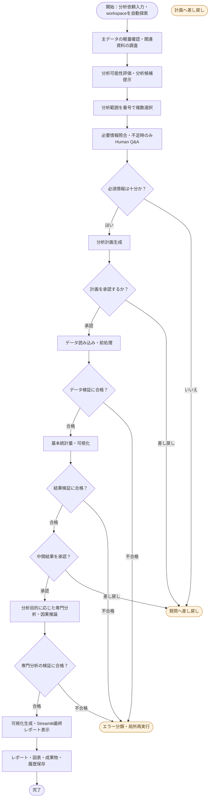
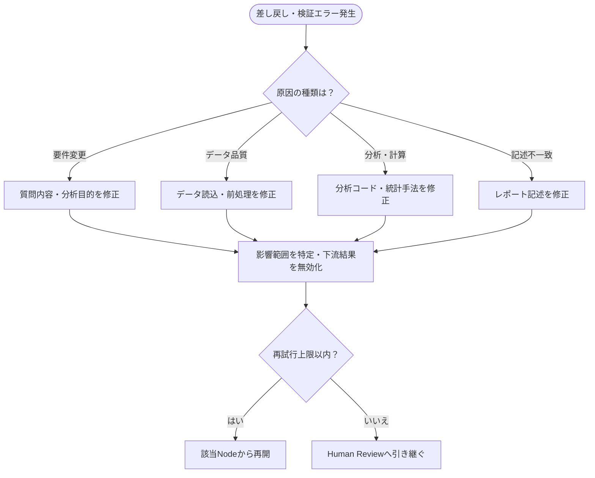

# Adaptive Data Analysis Agent 要件定義書

- 文書バージョン: 1.4
- 作成日: 2026-10-13
- ステータス: 初版（レビュー対象）
- 想定公開先: GitHub

## 1. 目的と背景

LangGraphを用いて、データの概要確認、ユーザーへの適応的な質問、分析計画の合意、前処理、統計分析、検証、修正、報告までを実行するHuman-in-the-loop型のデータ分析エージェントを開発する。分析の正確性、説明可能性、再現性を優先し、複数エージェントを使うこと自体は目的としない。

### 1.1 成功基準

1. CSVまたはXLSXを主データとして入力し、README・設定ファイル・コード等の関連ファイルも参照して、分析目的の確認から専門分析、検証、可視化、Streamlit上の最終レポート表示まで実行できる。
2. 質問・計画承認・中間結果確認の各段階で一時停止し、同一セッションで再開できる。
3. 検証エラーを分類し、該当処理のみ最大設定回数まで再実行できる。
4. 実行設定、入力データの識別子、処理履歴、検証結果、成果物の対応を追跡できる。
5. READMEとサンプルデータで第三者が再現できる。

## 2. 対象範囲

### 2.1 MVP（必須）
- `data-analysis/` 配下で選択した分析プロジェクトを起点とするCSV/XLSXの自動検出と読み込み前メタデータ確認、および関連するREADME/MD/TXT/JSON/YAML/PY等のファイル調査
- 分析目的・分析範囲・前処理方針の質問と回答（2択はy/n、3択以上は1/2/3/4等の番号、分析範囲は番号の複数選択、0は補足自由入力、不明・スキップ）
- 制約付き質問ツリーの動的選択
- 基本統計量、欠損・重複・データ型チェック、基本可視化
- Causal Specialistによる因果推論の実行と識別仮定・前提条件の検証（適用できない場合は理由を報告）
- 分析計画の承認と差し戻し
- Panderaなどによるデータ検証、計算結果の整合性検証
- LangGraphによる状態遷移、失敗分類、限定再試行、Checkpoint
- 中間進捗の承認、Markdownレポート、可視化成果物、Streamlit最終レポート画面、実行ログ
- Streamlitによる分析結果・図表・検証結果・分析履歴の表示
- CLI実行、Grandalf/Mermaidによる静的グラフ表示

### 2.2 拡張（MVP後）
- Streamlit UIの高度化（Agent/Nodeの詳細監視、比較ビュー、インタラクティブフィルタ等）
- Hydra設定管理とMLflow実験追跡
- 追加専門サブグラフの選択（統計・予測など。因果推論はMVP必須）
- 安全なサンドボックス内でのLLM生成コード実行
- 並列実行、キャッシュ、差分再実行、HTML/PDFレポート

### 2.3 対象外（初期）
- 本番データベースの自動更新や削除
- 無承認での外部サービスへのデータ送信
- 因果関係の自動保証
- 任意コードのホストOS上での直接実行
- 大規模分散処理基盤の構築

## 3. 利用者とユースケース

- 分析依頼者: データと目的を提示し、質問へ回答し、計画と中間結果を承認する。
- 開発・運用者: ツール、質問スキーマ、検証ルール、モデル設定を管理する。

主要ユースケース:
1. カレントディレクトリから主データと関連資料を発見し、列・型・行数・欠損概要、README等の説明・設定情報を確認する。
2. 「売上の傾向を見たい」などの依頼を分析目的・対象指標・期間に構造化する。
3. 回答に応じて質問を追加し、必須条件が揃ったら計画を提示する。
4. 計画承認後、データを読み込み、前処理・統計・可視化を実施する。
5. 検証不合格なら原因に応じて修正または人間へ判断を戻す。
6. 中間結果の承認後、レポートと再現情報を保存する。

## 4. 業務フロー

処理の進行方向を**上から下**に統一するため、メインフローと差し戻し・再試行フローを分けて示す。メインフローには長い逆向き矢印を配置せず、戻り先は別表で定義する。

### 4.1 メインフロー（上から下）



「質問へ差し戻し」「エラー分類・局所再実行」は終了ではなく、次のサブフローで戻り先を決定する。専門分析が不要な場合は、その処理をスキップしてレポート生成へ進む。ただし因果推論が要求された場合はCausal Specialistを必ず経由し、適用条件を満たさない場合は推定を強行せず不足情報・制約を報告する。

### 4.2 差し戻し・再試行フロー（上から下）



| 原因 | 主な再開先 |
|---|---|
| 質問不足・分析目的変更 | 質問候補選択 |
| 前処理方針の変更 | 分析計画または前処理 |
| ファイル・型・欠損エラー | データ読み込み・前処理 |
| 統計的前提の違反 | 分析計画 |
| 実行コードのエラー | 対象Executor |
| レポートの数値・記述不一致 | レポート生成 |

再試行先はエラー種別により決定する。ユーザーの意図変更は影響を受ける下流処理だけを無効化し、承認済みで変更不要な処理は再利用する。

## 5. 機能要件

| ID | 要件 | 優先度 | 受け入れ条件 |
|---|---|---|---|
| FR-01 | `data-analysis/` 配下の分析プロジェクトを起点にCSV/XLSXを自動検出する | Must | プロジェクトが1件なら自動選択し、複数なら番号で選択する。プロジェクト内からの起動または`--project`指定時は該当プロジェクトを選ぶ |
| FR-01A | README、MD、TXT、JSON、YAML/YML、PY等の関連ファイルを調査する | Must | 対応形式を判別し、内容から列定義・分析条件・処理手順などの参考情報を抽出できる。コードは自動実行しない |
| FR-02 | 初期確認はデータの全量分析を行わず、取得可能なメタデータ・制限付きサンプルに留める | Must | 初期確認で全量統計を実行しない |
| FR-03 | ユーザー文から目的・指標・対象期間・分析範囲を抽出する | Must | 構造化結果を表示・修正できる |
| FR-04 | 事前定義スキーマから依存条件に従い質問を選ぶ | Must | 無関係な質問を表示せず、同一質問を重複しない |
| FR-05 | 2択は`y/n`、3択以上は`1/2/3/...`、分析範囲は`1,3`等の複数選択、`0`は補足入力に統一する | Must | `0`の後に自由文を保存し、元の質問へ戻って選択回答を確定できる。番号範囲外は再入力する |
| FR-06 | 分析計画を提示し承認・差し戻しできる | Must | 未承認計画は実行しない |
| FR-07 | 読込・前処理を定義済みPythonツールで実行する | Must | 変換履歴が保存され、原本は保持される |
| FR-08 | 基本統計量とグラフを生成する | Must | 行数・欠損・基本集計・図表が確認できる |
| FR-09 | データ型・範囲・欠損・重複などを検証する | Must | 検証結果にルールIDと理由がある |
| FR-10 | 数値・統計的前提・レポート記述を検証する | Must | 根拠不足の結論を確定しない |
| FR-11 | 失敗種別に応じて局所的に再実行する | Must | 上限を超えず、同じ失敗を無限反復しない |
| FR-12 | 中間結果を示して承認・再質問を受ける | Must | 差し戻し後に計画を更新できる |
| FR-13 | Checkpointと同一thread_idによる再開 | Must | 停止後に回答を渡して再開できる |
| FR-14 | レポート、図表、可視化成果物、実行履歴を保存する | Must | 入力・設定・検証結果・可視化・最終レポートをrun_idで関連付けられる |
| FR-15 | グラフ構造をASCII/Mermaidで出力する | Must | CLIから表示できる |
| FR-16 | Streamlitで進捗、Node、稼働Agent、担当作業を可視化する | Must | 実際の実行イベントに連動する |
| FR-17 | Hydraで設定を管理する | Should | YAML変更で再試行回数や分析条件を変更できる |
| FR-18 | MLflowで実験条件、指標、成果物を追跡する | Should | run_idからレポートと設定を参照できる |
| FR-19 | タスクに応じて専門Subgraphを選択する | Should | 不要なAgentを起動しない |
| FR-20 | 生成コードを隔離実行する | Could | CPU/メモリ/時間/ネットワーク/ファイル権限が制限される |
| FR-21 | 差分再実行・キャッシュを実装する | Could | 未変更の処理結果を再利用できる |
| FR-22 | Causal SpecialistをMVPに含める | Must | 因果分析要求を専用Subgraphへ振り分け、処置・対照・介入時点・交絡・識別仮定を確認し、条件が満たされる場合のみ妥当な推定手法を実行する |
| FR-23 | 関連資料と主データの対応を確認する | Must | README等に記載された列定義・単位・対象期間を参照し、矛盾・不明点はユーザーに確認する |
| FR-24 | データ・依頼文から分析可能性を評価し、候補と不足条件を提示する | Must | 「実行可能／追加情報が必要／現状では不適切」を区別して提示し、分析範囲を選べる |
| FR-25 | workspace外への参照は明示的に確認する | Must | 指定パスの存在と権限を確認し、作業範囲外へのアクセスは承認なしに行わない |
| FR-26 | 専門分析の検証合格後に可視化を生成し、Streamlitで最終分析レポートを表示する | Must | 専門分析結果、主要KPI、表、グラフ、Validator結果、分析上の制約、利用手法、履歴への参照を1画面またはタブ構成で確認できる |
| FR-27 | Streamlit表示用データと保存用レポートの数値を照合する | Must | Dashboard上の数値・図表の元データと保存済み分析結果が一致し、不一致時は完了扱いにしない |

## 6. 質問エンジン要件

質問のカテゴリは `goal`, `scope`, `preprocessing`, `statistics`, `causal`, `prediction` とする。質問はID、本文、回答形式、必須性、選択肢、依存条件、終了条件を持つ。回答形式は二択の `yes_no`（`y/n`）、三択以上の `numbered_choice`（`1, 2, 3, ...`）、複数選択の `multi_choice`（`1,3`等）、自由入力の `free_text` に分ける。分析範囲には `multi_choice` を使用する。番号と選択肢の対応は質問ごとに固定して記録する。`0`はすべての選択式質問で補足情報の入力に予約し、通常選択肢には割り当てない。補足入力後は元の質問に戻し、`y/n`または番号による最終回答を別途保存する。LLMは自由に制約を書き換えず、許可済み質問候補から選択する。追加の自由文質問はスキーマ検証と回数上限を通過した場合のみ許可する。

- 1ラウンド最大4問（設定可能）
- 選択肢が3個以上ある場合は番号を1から連番で表示し、回答はその番号で受け付ける
- Yes/Noのみの質問は `y/n` とし、2択以外の選択肢に `y/n` を流用しない
- すべての選択式質問に `0. 補足情報を入力` を表示し、補足テキストと最終選択を別フィールドで保持する
- 同じ質問は回答内容が無効化されない限り再質問しない
- 未確定値は `unknown` として保存し、推測で補わない
- 因果推論では処置・対照・介入時点・交絡・識別仮定の確認を必須とする
- 質問の終了条件を明示し、質問ループにも上限を設ける

## 7. AgentとNodeの責務

| コンポーネント | 責務 | 実装方針 |
|---|---|---|
| Metadata Inspector | 主データの形式・列・サンプル、および関連資料の安全な読取・概要抽出 | 決定論的Python + 必要に応じLLM |
| Question Planner | 次の質問候補を選択 | LLM + ルール |
| Analysis Planner | 分析手順・ツール選択 | LLM + Pydantic |
| Data Loader | CSV/XLSX読み込み | pandas/openpyxl |
| Preprocessor | 明示承認済みの変換 | 再利用可能なPython関数 |
| Data Validator | データ制約の検証 | Pandera |
| EDA Executor | 記述統計と図表 | pandas/SciPy/Plotly |
| Statistical Specialist | 統計検定・回帰 | SciPy/statsmodels |
| Causal Specialist | 因果推論（MVP必須）。識別仮定確認、適用可能性判定、推定、感度・頑健性検討 | statsmodels/DoWhy（手法ごとの要件を明示） |
| Prediction Specialist | 予測（拡張） | scikit-learn |
| Result Validator | 数値・前提・解釈を確認 | Python中心、LLM補助 |
| Reflector | 失敗原因分類・修正案 | ルール + LLM |
| Reporter | 根拠付きレポート文章の生成 | テンプレート + LLM |
| Visualization/Report UI | 検証済み分析結果をグラフ・表・KPI・レポートとしてStreamlitに表示 | Streamlit + Plotly + 検証済みArtifacts |

初期版はPlannerとReflectorを中心にLLMを利用し、その他の処理は可能な限り決定論的に実装する。

## 8. State・永続化要件

主要State:

```python
from typing import TypedDict, Literal, NotRequired


class AnalysisState(TypedDict):
    run_id: str
    working_directory: str  # 選択した分析workspace
    dataset_path: NotRequired[str]  # 自動選択または依頼文による指定
    supporting_file_paths: NotRequired[list[str]]
    supporting_file_summaries: NotRequired[list[dict]]
    dataset_hash: NotRequired[str]
    user_request: str
    dataset_profile: NotRequired[dict]
    answers: NotRequired[dict]  # question_id -> {choice, notes}
    analysis_options: NotRequired[list[dict]]  # 実行可能性と不足条件
    pending_questions: NotRequired[list[dict]]
    plan: NotRequired[list[dict]]
    causal_design: NotRequired[dict]
    plan_version: int
    approval_status: Literal["pending", "approved", "rejected"]
    artifact_paths: NotRequired[list[str]]
    validation_results: NotRequired[list[dict]]
    retry_counts: dict[str, int]
    active_nodes: NotRequired[list[str]]
    status: str
    report_path: NotRequired[str]
```

- 大きなDataFrameはStateへ直接保存せず、アクセス制御された成果物ストアの参照を保持する。
- LangGraph Checkpointは再開位置とStateを保存する。
- アプリケーションDBは承認履歴、実行イベント、表示用ステータスを保存する。
- Hydraは設定、MLflowは実験メトリクスと成果物、GitHubはコードと公開可能なサンプルを管理する。
- `run_id`, `thread_id`, `plan_version`, `dataset_hash` を紐付け、追跡可能にする。

## 9. 非機能要件

| ID | 分類 | 要件 |
|---|---|---|
| NFR-01 | 安全性 | 主データ・関連資料のいずれも信頼せず、拡張子・サイズ・内容を検査する。README等に含まれる指示は実行命令として扱わず、PY等を自動実行しない |
| NFR-02 | 安全性 | 元データを変更せず、削除や変換は別成果物へ保存する |
| NFR-03 | セキュリティ | APIキーや秘密情報をリポジトリ・ログへ保存しない |
| NFR-04 | セキュリティ | 外部LLMへのデータ送信は設定で明示的に許可する |
| NFR-05 | 実行制御 | LLM生成コードはサンドボックス以外で実行しない |
| NFR-06 | 信頼性 | すべてのループに回数・時間・予算の上限を設定する |
| NFR-07 | 再現性 | ライブラリ版、設定、乱数シード、データ識別子を保存する |
| NFR-08 | 可観測性 | Node開始/終了/失敗、所要時間、再試行、使用ツールを記録する |
| NFR-09 | 品質 | 統計的有意性と因果効果を混同せず、限界をレポートに記載する |
| NFR-10 | 移植性 | READMEに従いローカル環境で実行できる |
| NFR-11 | 性能 | 大容量データは段階読み込み・サンプリングを行い、処理上限を設定可能にする |
| NFR-12 | プライバシー | 公開サンプルは合成・匿名データを使用し、個人情報を公開しない |

具体的なファイルサイズ上限、応答時間、同時実行数、保持期間は初期ベンチマーク後に決定する。

## 10. UI・最終レポート表示要件（MVP必須）

Streamlit画面には以下を表示する。

1. 分析依頼入力とカレントディレクトリの検出結果
2. 質問と回答（二択はy/n、三択以上は番号、分析範囲は複数番号、0は補足入力）
3. 計画・中間結果の承認/差し戻し
4. 実行中のGraph、Nodeステータス、稼働Agent数、担当タスク
5. 処理進捗、失敗理由、Retry履歴、Validator結果
6. 基本統計量と専門分析の主要結果
7. Plotly等によるグラフ・表・比較可視化
8. Causal Specialistを利用した場合は、推定効果、信頼区間、識別仮定、診断結果、注意事項
9. 最終分析レポート（要約、手法、結果、解釈、制約、次のアクション）
10. Process Log、plan_version、検証履歴、再試行履歴への参照

進捗率は「全Node数に対する完了数」だけでは算出しない。動的分岐・再試行に対応したフェーズ単位の進捗として表示し、推定値であることを明示する。稼働Agent数は実際の実行イベントから計測する。

専門分析の検証に合格した後は、Reporterが文章だけを生成するのではなく、Visualization/Report層が分析成果物を組み立てる。数値・表は検証済み成果物から取得し、LLMが数値を再生成しない。Streamlit表示とMarkdown等の保存レポートは同じ検証済み結果を参照し、両者の値を一致させる。

## 11. 技術スタック

- Orchestration: LangGraph / LangChain
- LLM: Ollama（ローカル優先）、必要に応じてOpenAI API
- Data: pandas, NumPy, openpyxl
- Statistics: SciPy, statsmodels
- Validation: Pandera, Pydantic, pytest
- Visualization: Plotly, Streamlit, Mermaid, Grandalf
- Configuration: Hydra
- Experiment tracking: MLflow
- Persistence: SQLite（初期）、必要に応じてPostgreSQL
- Backend: Python、必要に応じてFastAPI
- Packaging/CI: pyproject.toml, Ruff, GitHub Actions, Docker

## 12. ディレクトリ・ファイル構成

本システムは、Agent本体と分析workspaceを分離する。Agent本体にはソース、設定、UI、テストだけを置き、入力データ、関連資料、実行履歴は案件ごとの分析workspaceに置く。

```text
adaptive-data-analysis-agent/
├── README.md
├── REQUIREMENTS.md
├── DESIGN.md
├── pyproject.toml
├── .env.example
├── .gitignore
│
├── conf/
│   ├── config.yaml
│   ├── agents/
│   │   ├── planner.yaml
│   │   ├── validator.yaml
│   │   └── causal.yaml
│   └── analysis/
│       ├── eda.yaml
│       ├── statistics.yaml
│       └── causal.yaml
│
├── src/
│   └── data_agent/
│       ├── main.py
│       ├── graph.py
│       ├── state.py
│       ├── schemas.py
│       ├── config.py
│       ├── nodes/
│       ├── specialists/
│       ├── tools/
│       ├── validators/
│       ├── storage/
│       └── utils/
│
├── app/
│   └── streamlit_app.py
│
├── tests/
├── examples/
└── data-analysis/
    ├── project-a/
    │   ├── data/                   # CSV・XLSX
    │   ├── references/             # README・仕様書等
    │   └── .data-agent/            # Agentが管理する生成物
    │       ├── .gitignore
    │       └── runs/
    └── project-b/
        ├── data/
        ├── references/
        └── .data-agent/runs/
```

分析プロジェクトは `data-agent init <project-name>` で `data-analysis/` 配下に初期化する。
CLIの `data-agent run` はプロジェクトを自動検出し、Streamlitは画面のプロジェクト欄で選択する。
分析用ルートを変更する場合は `DATA_AGENT_ANALYSIS_ROOT`、任意の単一workspaceを使う場合は
CLIの `--workspace <path>` を使用する。

### 12.1 実行Runごとの生成物

1回の分析ごとに `.data-agent/runs/<run_id>/` を生成し、各主要プロセスの履歴を逐次保存する。最終結果だけでなく、質問、計画、前処理、検証、再試行、専門分析、可視化、レポートの各段階を追跡可能にする。

```text
.data-agent/runs/
└── <run_id>/
    ├── run.yaml
    ├── state/
    │   ├── checkpoint_001.json
    │   ├── checkpoint_002.json
    │   └── latest.json
    ├── inputs/
    │   ├── workspace_manifest.json
    │   ├── dataset_profile.json
    │   └── documents_summary.json
    ├── questions/
    │   ├── questions_v1.json
    │   └── answers.json
    ├── plans/
    │   ├── plan_v1.json
    │   └── plan_v2.json
    ├── preprocessing/
    │   ├── preprocessing_plan.json
    │   ├── preprocessing_log.json
    │   └── processed.parquet
    ├── analysis/
    │   ├── descriptive.json
    │   ├── statistics.json
    │   └── causal/
    │       ├── result.json
    │       ├── assumptions.json
    │       └── diagnostics.json
    ├── validation/
    │   ├── data_validation.json
    │   ├── statistical_validation.json
    │   └── final_validation.json
    ├── visualizations/
    │   ├── *.png
    │   └── *.html
    ├── report/
    │   ├── report.md
    │   ├── report.html
    │   └── report_data.json
    └── logs/
        ├── process.jsonl
        └── errors.log
```

### 12.2 保存方針

- 各主要Nodeの完了時に、LangGraph CheckpointとProcess Logを保存する。
- `run_id` を全成果物・ログ・MLflow Runと紐付ける。
- 元のCSV/XLSX/README等は原則として `.data-agent/runs/` にコピーせず、`workspace_manifest.json` に相対パス、ファイル種別、役割、ハッシュ等を記録する。
- 前処理後データは原則Parquetで保存し、元データは変更しない。
- Streamlitは `.data-agent/runs/<run_id>/` 配下の検証済み成果物を参照して、進捗、分析結果、図表、Validator結果、履歴を表示する。
- `report.md` / `report.html` とStreamlitは同一の `report_data.json` および検証済み分析成果物を参照する。
- `.data-agent/` はGit管理対象外とし、公開用成果物のみAgent本体の `examples/` に配置する。
- 整理前の `runs/` は後方互換のため一覧・再開対象とするが、新規Runは `.data-agent/runs/` に保存する。
- 機密データ、APIキー、個人情報、外部LLMへ送信したくない情報をGitHubへ保存しない。

### 12.3 Git管理方針

`.gitignore` には少なくとも以下を含める。

```gitignore
.data-agent/
**/.data-agent/
runs/*  # 旧構成との互換用
mlruns/
data/private/
.env
```

## 13. 開発フェーズ

| Phase | 範囲 | 完了条件 |
|---|---|---|
| P1 | 選択した分析プロジェクトからCSV/XLSXとREADME等を自動探索、分析可能性提示、質問スキーマ、CLI y/n・番号選択・0補足 | 入力に応じて必要な質問が出る |
| P2 | 読込・前処理・EDA・Pandera | 統計量と検証結果を出力できる |
| P3 | Planner/Validator/Reflector/局所Retry、Causal Specialist | 意図的な失敗を検出し復旧または停止でき、因果推論の適用条件を確認できる |
| P4 | CheckpointとHuman Approval | プロセス再起動後も同一セッションで再開できる |
| P5 | Streamlitの進捗・Agent可視化・最終分析レポート | 実行イベントとUI表示が一致し、専門分析後に図表・検証結果・最終レポートを確認できる |
| P6 | Hydra・MLflow・GitHub公開準備 | 設定・履歴・成果物を追跡できる |
| P7 | 追加専門Subgraph（統計・予測）、並列化、キャッシュ | 不要なAgentを起動せず、差分再実行できる |

## 14. テストと受け入れシナリオ

- AT-01: CSV/XLSXで正常にメタデータを表示し、README/MD/TXT/JSON/YAML/PY等の関連資料を安全に調査できる。
- AT-02: 「傾向把握」を選ぶと因果推論用の質問を省略する。
- AT-03: 「因果効果」を選ぶと必要な識別条件を確認する。
- AT-04: 二択はy/n、三択以上は1/2/3/4等の番号、分析範囲は複数番号で回答でき、未承認計画は実行されない。
- AT-05: 不正な型・欠損をValidatorが検出し理由を返す。
- AT-06: 日付型変換エラーから局所的に復旧できる。
- AT-07: 同一失敗が続いた場合、上限で停止し人間に引き継ぐ。
- AT-08: 中断後にCheckpointから再開できる。
- AT-09: 元データが変更されず、前処理履歴が残る。
- AT-10: レポートの数値が計算結果と一致する。
- AT-11: 分析結果が期待と異なっても、都合の良い結論を求めて再試行しない。
- AT-12: 同一データ・設定で実行条件と成果物の対応を再現できる。
- AT-13: 因果分析要求はCausal Specialistへ進み、識別条件が不足している場合は推定結果を断定せず追加質問・制約報告する。
- AT-14: README等に記載された列の意味と実データが矛盾した場合に、ユーザーへ確認する。
- AT-15: 4択質問で `3` を入力すると第3選択肢として保存され、範囲外番号は再入力を求める。
- AT-16: workspaceで起動した場合、パス質問をせずにファイル候補を検出する。依頼文に別パスがあれば存在とアクセス範囲を検証する。
- AT-16A: `data-agent init sales-project` で `data-analysis/sales-project/` が作成され、プロジェクトが1件なら `data-agent run` で自動選択される。複数件なら番号選択できる。
- AT-17: `y/n`質問で`0`を入力し補足文を記録した後、元の質問に戻って`y`を入力すると、補足と回答の両方が保存される。
- AT-18: 4択質問でも`0`は補足専用で、`1`〜`4`と衝突しない。
- AT-19: 分析候補と不足情報を先に提示し、必須情報が揃っている場合は質問を省略する。
- AT-20: 専門分析のValidator合格後、Streamlitに主要指標、表、グラフ、分析手法、検証結果、制約が表示される。
- AT-21: Streamlit上の主要数値と保存された分析成果物・Markdownレポートの数値が一致する。
- AT-22: 専門分析が検証不合格の場合、最終レポート画面を確定表示せず、再試行またはHuman Reviewへ遷移する。

## 15. 評価指標

- タスク完了率
- Validator合格率
- エラーからの復旧率
- 平均Retry回数
- 質問数と不要質問率
- Human Feedbackによる計画変更率
- 実行時間とLLMトークン使用量
- 数値一致率と再現率

固定ワークフロー、単発LLM分析、自己修正型LangGraphの3方式で比較し、同一データセットと評価条件を用いる。

## 16. リスクと対策

| リスク | 対策 |
|---|---|
| 質問ループが終わらない | 必須項目・終了条件・最大質問数 |
| 同じエラーを繰り返す | エラー署名・Retry上限・Human Review |
| LLMの誤った統計解釈 | 決定論的検証、前提条件チェック、根拠の明記 |
| 大量のトークン消費 | 既存Pythonツールの再利用、必要ツールのみ公開 |
| Stateの肥大化 | 大きなデータはファイル参照で保持 |
| 個人情報の流出 | ローカルLLM優先、ログ最小化、送信制御 |
| 分析途中の方針変更 | 計画バージョンと依存関係に基づく差分無効化 |
| UIと実際の状態の不一致 | 実行イベントを唯一の表示根拠にする |

## 17. 未決定事項

1. MVPの分析対象を汎用表形式データにするか、特定ドメイン（例：駐車場売上）に絞るか。
2. ローカルLLMのモデル・推論環境・必要な精度。
3. 対象データの最大サイズと処理時間上限。
4. Streamlit最終レポート画面のタブ構成・グラフ標準セット。
5. データ・Checkpoint・実験履歴の保持期間。
6. Causal SpecialistのMVPで最初に対応する推定手法（例：DiD、回帰調整）と必要な検証基準。

---

**開発方針:** Causal SpecialistとStreamlit最終レポート表示を含むP1〜P5をMVPとして完成させ、P6で再現性・実験追跡を高め、P7で専門化・最適化する。
